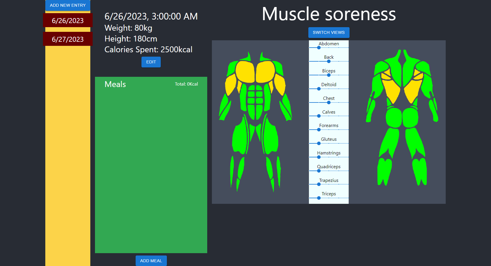

# Fitness Tracker

A full-stack fitness tracking app for logging daily health metrics, muscle soreness, workouts, and meals. Browse historical entries by date and manage everything from a single dashboard.



## Features

- **Daily health log** — Record weight, height, calories burned, and date for each entry
- **Muscle soreness map** — Visual body diagram with sliders for 12 muscle groups (chest, back, arms, legs, core, and more)
- **Workout routines** — Add exercises with reps, added weight, rest intervals, and per-exercise target muscles
- **Meal tracking** — Log meals with calories and macros (fat, carbohydrates, protein)
- **History browser** — Switch between past entries and create new daily logs

## Tech Stack

| Layer | Technologies |
|-------|--------------|
| **Backend** | Java 17, Spring Boot 3.1, Spring Data JPA, H2 |
| **Frontend** | React 18, TypeScript, Material UI |
| **Build** | Maven, Create React App |

## Project Structure

```
fitness/
├── src/main/java/lv/venta/fitness/   # Spring Boot API (controllers, services, models)
├── src/main/resources/               # Application config and Thymeleaf templates
├── app/                              # React frontend
│   └── src/
│       ├── components/               # UI components (HealthSummary, MuscleStatus, etc.)
│       └── images/muscles/           # Muscle group diagram assets
└── pom.xml                           # Maven dependencies
```

## Prerequisites

- **Java 17** or later
- **Maven** 3.6+
- **Node.js** 16+ and npm — [nodejs.org](https://nodejs.org/)

## Getting Started

The app runs as two services: a Spring Boot API on port **8080** and a React dev server on port **3000** (proxied to the API).

### 1. Start the backend

From the project root:

```bash
./mvnw spring-boot:run
```

Or, if you have Maven installed globally:

```bash
mvn spring-boot:run
```

The API starts at [http://localhost:8080](http://localhost:8080). Sample health data is seeded on first launch.

### 2. Start the frontend

In a separate terminal:

```bash
cd app
npm install
npm start
```

Open [http://localhost:3000](http://localhost:3000) in your browser.

## API Overview

All REST endpoints are served under `http://localhost:8080`.

| Resource | Base path | Key endpoints |
|----------|-----------|---------------|
| Health data | `/healthData` | `GET /showAll`, `GET /entry/{id}`, `GET /getFresh`, `POST /update/{id}` |
| Meals | `/meal` | `GET /showAll/{id}`, `GET /getFresh/{id}`, `POST /update/{id}`, `GET /delete/{idme}` |
| Exercises | `/exercise` | `GET /showAll/{id}`, `GET /insertNewExercise/{id}`, `POST /update/{id}`, `GET /delete/{id}` |
| Muscle groups | `/muscle` | `GET /getByHealthData/{id}`, `POST /updateByHealthData/{id}`, `GET /getByExercise/{id}`, `POST /updateByExercise/{id}` |

The React dev server proxies API requests to the backend via the `proxy` setting in `app/package.json`.

## Development

```bash
# Run backend tests
mvn test

# Run frontend tests
cd app && npm test

# Production frontend build
cd app && npm run build
```